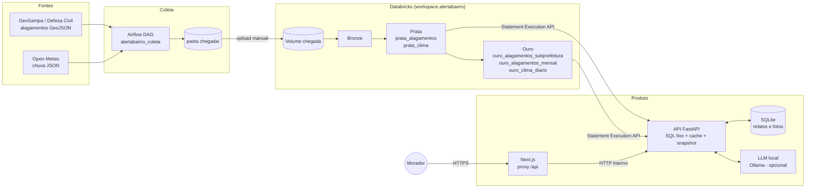

# Arquitetura

## Componentes

| Componente | Responsabilidade | Tecnologia |
| --- | --- | --- |
| Pipeline de dados | Coleta, Bronze/Prata/Ouro, qualidade | Airflow, Databricks Free Edition, Delta |
| API | Lê o lakehouse com SQL fixo; cache (10 min); fallback para o snapshot; relatos; índice; assistente; métricas | FastAPI, Python 3.12 |
| Frontend | Telas, mapa, gráficos, formulário; proxy `/api/*` para a API | Next.js 15, React 19, Leaflet |
| Assistente | Busca na base com fonte → geração fundamentada → validação do JSON | BM25 próprio, LLM via API compatível com OpenAI |
| Observabilidade | Métricas, alertas e painel | Prometheus, Grafana |

## Decisões

1. **O app nunca fala direto com o Databricks.** O relatório técnico recomenda uma API própria. O token fica só no servidor, e o navegador conversa apenas com o frontend.
2. **Snapshot validado como plano B.** O critério de aceite exige uma URL pública funcionando durante a correção. Como a Free Edition não tem SLA, a API serve os valores do relatório quando o Databricks falha, e a tela informa isso.
3. **Filtros do mapa aplicados em Python.** A Prata tem ~300 linhas. A API busca tudo uma vez (com cache) e filtra em memória, sem montar SQL com texto do usuário.
4. **Índice por regras antes de ML.** A proposta prevê ML só com dados rotulados e validação temporal. As regras ficam visíveis na tela.
5. **Relatos em SQLite.** Atende ao MVP com uma instância. Para escalar, a troca natural é PostgreSQL/PostGIS.
6. **Proxy no Next.js.** Evita CORS, mantém a API em rede interna e permite trocar `API_URL` sem novo build.

## Onde ficam os dados pessoais (LGPD)

| Dado | Onde | Proteção |
| --- | --- | --- |
| Descrição do relato | SQLite da API | Bloqueio de e-mail/CPF/telefone; só publicada após moderação |
| Localização do relato | SQLite da API | Arredondada para 3 casas decimais (~110 m) |
| Foto | Volume da API (`/app/var/uploads`) | EXIF/GPS removidos; apagada ao rejeitar ou após 90 dias |
| IP de quem acessa | Memória da API (limite de taxa) | Não é gravado em disco nem nos logs |
| Alagamentos e chuva | Databricks | Dados públicos, sem dado pessoal |

## Responsabilidade compartilhada

O provedor de nuvem cuida da infraestrutura física, da rede e do hipervisor. A equipe cuida de:

- imagens (não root, sem segredos);
- variáveis secretas;
- atualização de dependências (Trivy no CI);
- regras de acesso (moderação por token);
- retenção de dados e moderação do conteúdo.
