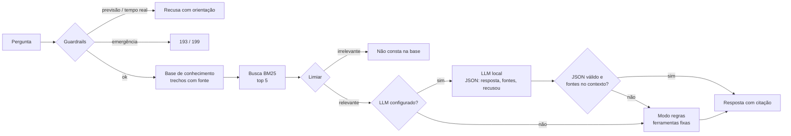

# Assistente de IA

Este documento descreve o que o assistente já faz no MVP e o que ainda falta para a disciplina **Generative AI for Engineering** (LLM local para segurança e mobilidade; o problema dos alagamentos se encaixa nos dois).

## Pipeline atual



| Etapa | Arquivo | Detalhe |
| --- | --- | --- |
| Guardrails | `backend/app/assistente/guardrails.py` | Recusa previsão ("vai alagar", "amanhã", "agora") e prioriza emergência |
| Base de conhecimento | `backend/app/assistente/base_conhecimento.py` + `backend/base_conhecimento/*.md` | 97 trechos com dados do Databricks (58 com o snapshot): um por fato da Ouro (subprefeitura, mês, dia de chuva, índice) e um por seção dos documentos |
| Busca | `backend/app/assistente/busca.py` | BM25 com radical leve em português |
| Limiar | `backend/app/assistente/regras.py` | `LIMIAR_RELEVANCIA = 2.0` e `COBERTURA_MINIMA = 0.5` (fração dos termos da pergunta no trecho) |
| Geração | `backend/app/assistente/llm.py` | Prompt com regras, `temperature=0.1`, `response_format=json_object` |
| Validação | `validar_saida()` | JSON válido, fontes só do contexto, resposta afirmativa sem fonte é rejeitada |

Exportar a base para notebooks: `GET /api/v1/assistente/base`.

## Ligar um modelo local (Ollama)

```bash
ollama pull qwen2.5:3b-instruct
# no .env
LLM_BASE_URL=http://host.docker.internal:11434/v1   # ou http://localhost:11434/v1 fora do Docker
LLM_MODEL=alertabairro-lora                          # ou qwen2.5:3b-instruct (modelo base)
```

`GET /api/v1/assistente/info` passa a indicar `"modo": "llm"`, e as respostas mostram o modelo usado. Se o modelo devolver JSON inválido, citar um trecho inexistente ou afirmar algo sem fonte, a API volta ao modo regras, e essa resposta nunca chega à tela. Uma afirmação errada acompanhada de uma fonte válida ainda pode passar. O placar mede esse caso como "alucinação que chega ao usuário": 2% com o LoRA.

## Avaliação e especialização

A avaliação da disciplina está concluída. O relatório está em [`genai/RELATORIO_GENAI.md`](genai/RELATORIO_GENAI.md), e a reprodução, no README (seção "IA Generativa"). Resumo:

- 50 casos com gabarito em `avaliacao/casos_teste.jsonl`;
- recall@1 e recall@3 de 94,3%, com o limiar 2,0 justificado pela curva do notebook 01;
- placar das três configurações (sem contexto, RAG e LoRA + RAG) no notebook 03;
- modelo `alertabairro-lora` treinado no Colab (notebook 02) e servido pelo Ollama.

O limiar de relevância vale também no modo LLM: se nem o melhor trecho é relevante, a API recusa sem chamar o modelo (`modo: "limiar"`).
