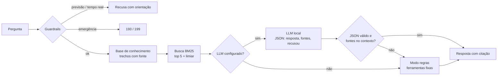

# Assistente de IA

Este documento descreve o que o assistente já faz no MVP e o que ainda falta para a disciplina **Generative AI for Engineering** (LLM local para segurança e mobilidade; o problema dos alagamentos se encaixa nos dois).

## Pipeline atual



| Etapa | Arquivo | Detalhe |
| --- | --- | --- |
| Guardrails | `backend/app/assistente/guardrails.py` | Recusa previsão ("vai alagar", "amanhã", "agora") e prioriza emergência |
| Base de conhecimento | `backend/app/assistente/base_conhecimento.py` + `backend/base_conhecimento/*.md` | ~60 trechos: um por fato da Ouro (subprefeitura, mês, dia de chuva, índice) e um por seção dos documentos |
| Busca | `backend/app/assistente/busca.py` | BM25 com radical leve em português |
| Limiar | `backend/app/assistente/regras.py` | `LIMIAR_RELEVANCIA = 2.0` e `COBERTURA_MINIMA = 0.5` (fração dos termos da pergunta no trecho) |
| Geração | `backend/app/assistente/llm.py` | Prompt com regras, `temperature=0.1`, `response_format=json_object` |
| Validação | `validar_saida()` | JSON válido, fontes só do contexto, resposta afirmativa sem fonte é rejeitada |

Exportar a base para notebooks: `GET /api/v1/assistente/base`.

## Ligar um modelo local (Ollama)

```bash
ollama pull qwen2.5:3b-instruct
# no .env
LLM_BASE_URL=http://host.docker.internal:11434/v1   # ou http://localhost:11434/v1 fora do Docker
LLM_MODEL=qwen2.5:3b-instruct
```

`GET /api/v1/assistente/info` passa a indicar `"modo": "llm"`, e as respostas mostram o modelo usado. Se o modelo devolver JSON inválido ou citar um trecho inexistente, a API volta ao modo regras. Uma alucinação nunca chega à tela.

## O que falta para a rubrica da disciplina

| Item da rubrica | Situação | Próximo passo sugerido |
| --- | --- | --- |
| 01 Tarefa e casos de teste com gabarito (incluindo "não consta") | Testes automatizados em `backend/tests/test_assistente.py` servem de base | Criar `avaliacao/casos.jsonl` com ~50 perguntas, a resposta esperada e o ID do trecho correto |
| 02 Base de conhecimento com fonte | Pronta (`/assistente/base`) | Montar a tabela fonte/formato/licença/nº de trechos em `base/` |
| 03 Recall@1 e @3 e limiar justificado | Busca e limiar prontos | Notebook que mede o recall nos casos e escolhe o limiar por curva |
| 04 JSON válido, citação e recusa | Pronto (`validar_saida` + guardrails) | Medir a taxa de JSON válido e de recusa correta |
| 05 Especialização (LoRA ou agente) x RAG simples | Cliente aceita qualquer modelo servido localmente | Afinar com LoRA ou montar um agente com ferramentas e comparar |
| 06 Placar das três configurações | — | Comparar modelo sem contexto × RAG × LoRA/agente nos mesmos casos |
| 07 Cinco erros reais com correção | — | Coletar das execuções do placar |
| 08 README e reprodutibilidade | Este documento | Adicionar notebooks com saídas salvas |

Como o assistente já está integrado ao produto, o modelo afinado entra no app só trocando `LLM_MODEL`.
