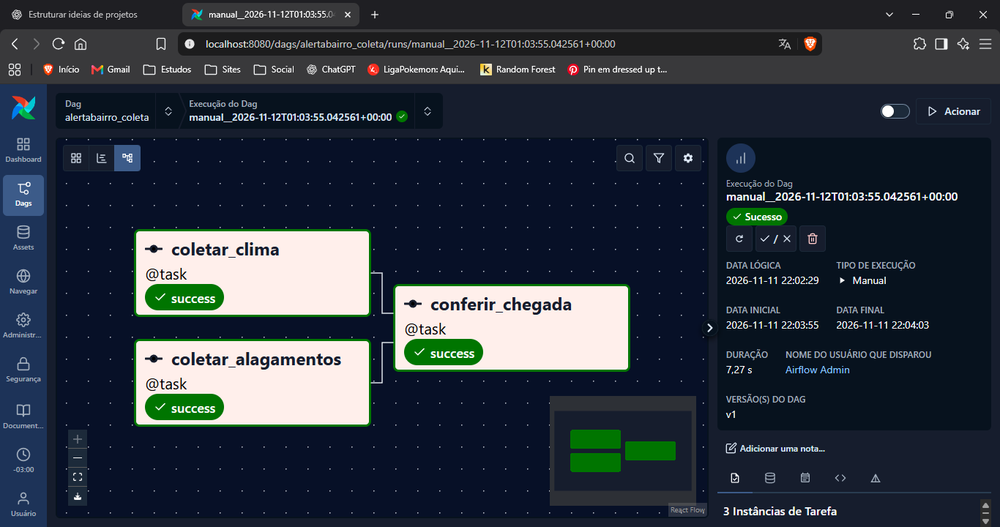
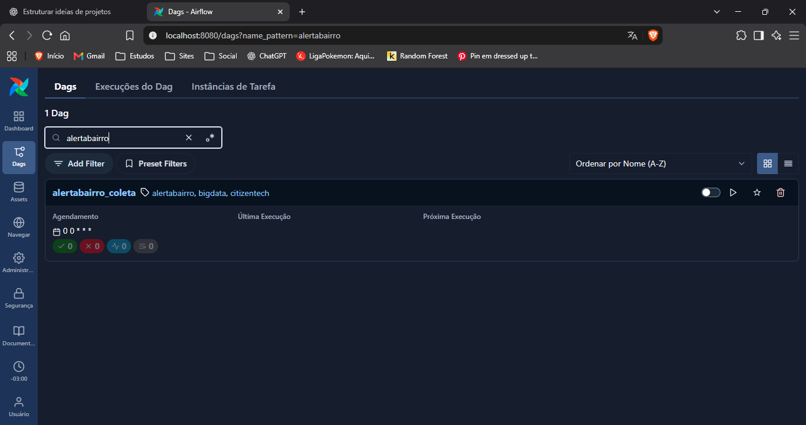
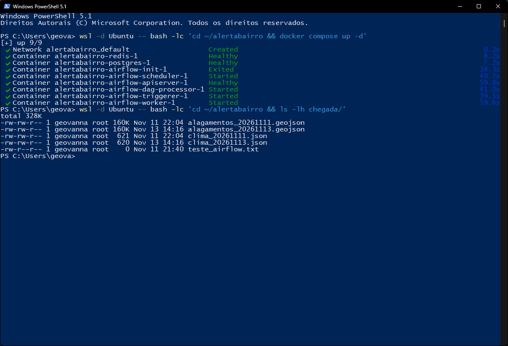

# Airflow - orquestração da coleta

Esta pasta reúne capturas reais fornecidas durante o desenvolvimento do AlertaBairro. Use os prints em tamanho original nas evidências do relatório.

### 01. Visão Graph - coleta paralela e validação dos arquivos, execução concluída

*Arquivo:* `01_graph_primeira_execucao.png` | *Critérios:* R02, R03.

### 02. Visão Graph - outra execução, três tarefas concluídas

*Arquivo:* `02_graph_segunda_execucao.png` | *Critérios:* R02, R03, R04.

### 03. DAG alertabairro_coleta localizada no Airflow

*Arquivo:* `03_dag_registrada_interface.png` | *Critérios:* R02, R09.

### 04. Pasta chegada/ com arquivos datados das duas fontes de coleta

*Arquivo:* `04_chegada_arquivos_dois_lotes.png` | *Critérios:* R02, R04.

