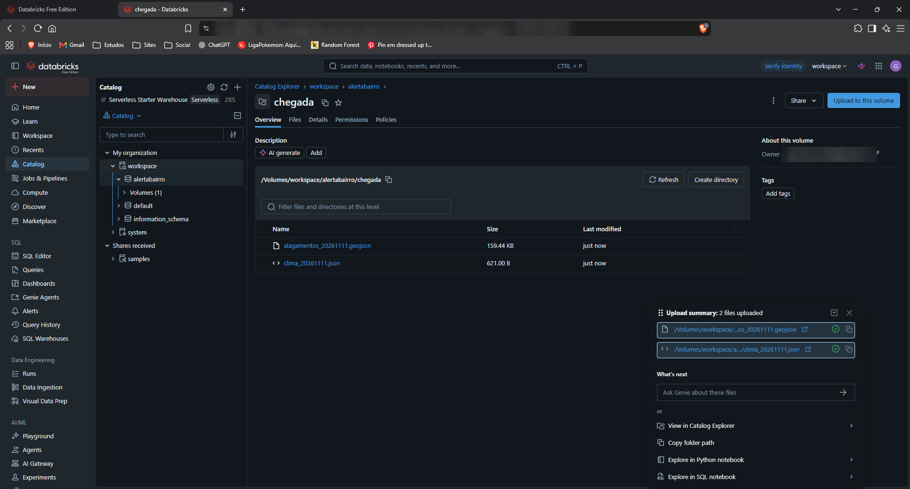
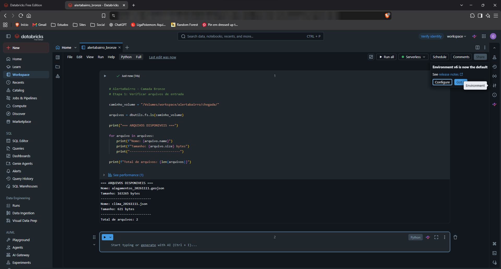
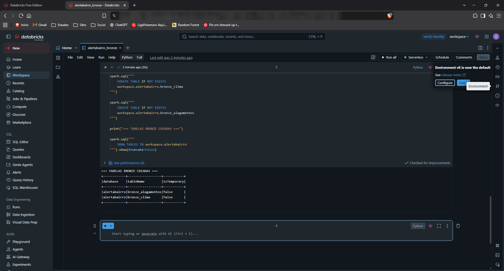
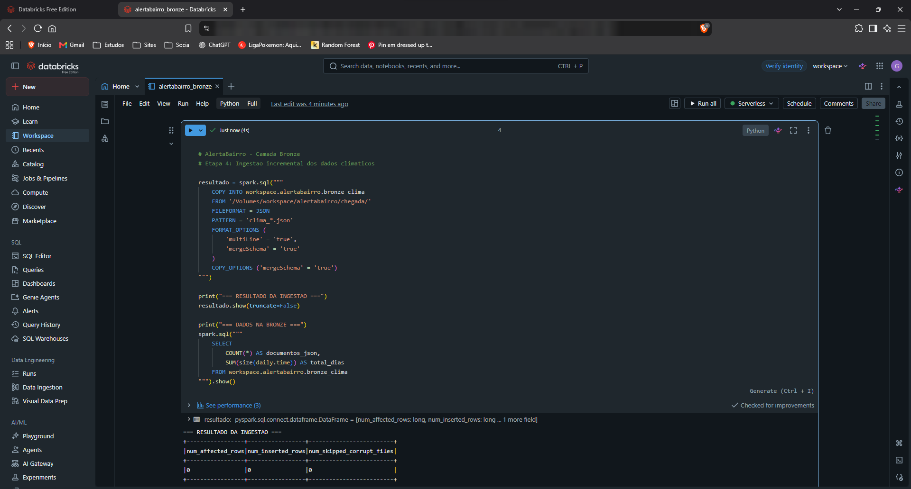
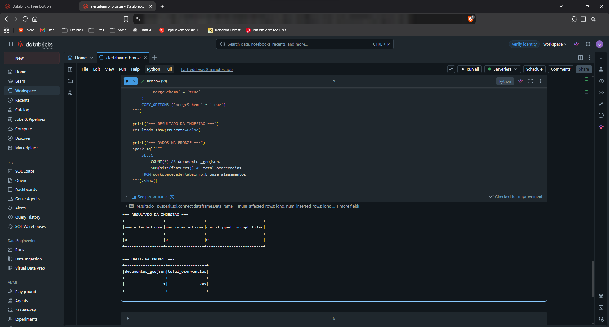

# Bronze - ingestão incremental

Esta pasta reúne capturas reais fornecidas durante o desenvolvimento do AlertaBairro. Use os prints em tamanho original nas evidências do relatório.

### 01. Volume Databricks chegada/ com arquivos enviados

*Arquivo:* `01_volume_arquivos_carregados.png` | *Critérios:* R04.

### 02. Listagem dos arquivos de entrada usados no notebook Bronze

*Arquivo:* `02_listagem_arquivos_bronze.png` | *Critérios:* R04, R05.

### 03. Bronze - tabelas brutas disponíveis no catálogo

*Arquivo:* `03_tabelas_bronze_criadas.png` | *Critérios:* R05.

### 04. COPY INTO clima - métricas de execução/reexecução

*Arquivo:* `04_copy_into_clima_reexecucao.png` | *Critérios:* R05.

### 05. COPY INTO alagamentos - métricas de execução/reexecução

*Arquivo:* `05_copy_into_alagamentos_reexecucao.png` | *Critérios:* R05.

