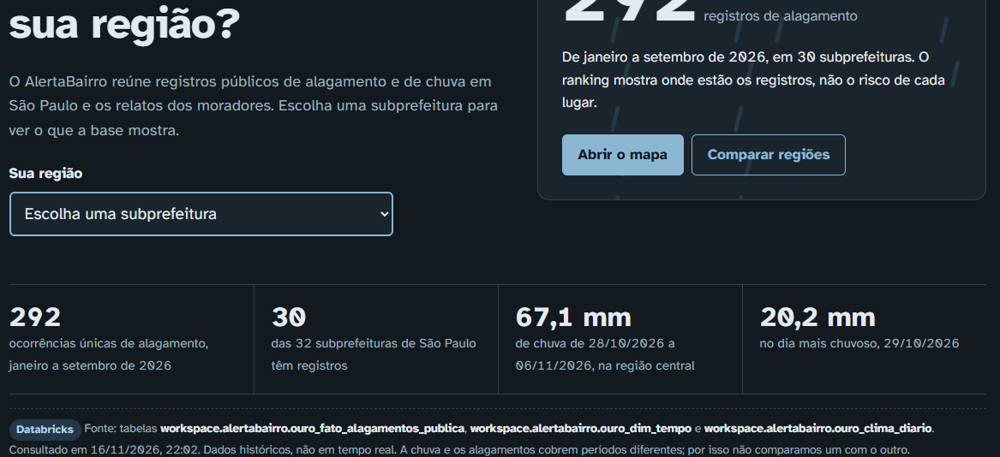

# MVP - evidência de consumo dos dados

Esta pasta reúne capturas reais fornecidas durante o desenvolvimento do AlertaBairro. Use os prints em tamanho original nas evidências do relatório.

### 01. Aplicação AlertaBairro exibindo 292 registros, 30 subprefeituras e indicadores climáticos

*Arquivo:* `01_mvp_tela_inicial_kpis.png` | *Critérios:* R08.

### 02. Site lendo ouro_fato_alagamentos_publica, ouro_dim_tempo e ouro_clima_diario (selo Databricks)

*Arquivo:* `02_mvp_lendo_ouro_publica.png` | *Critérios:* R08.
