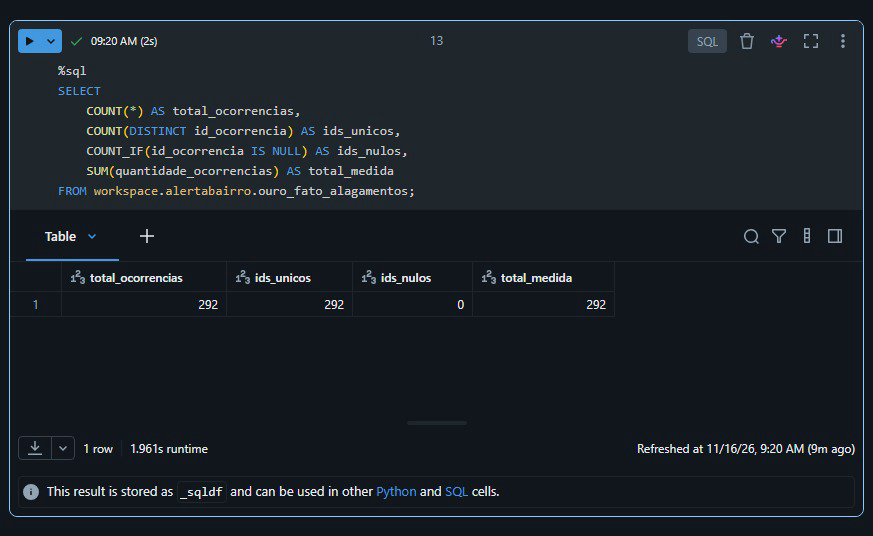
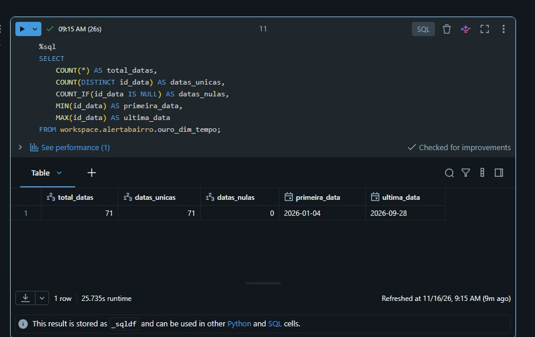
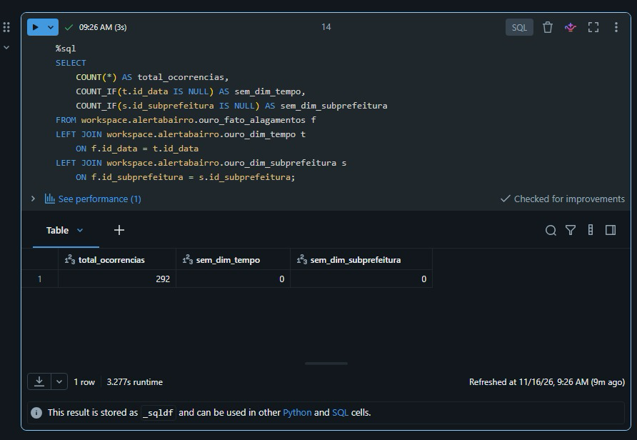
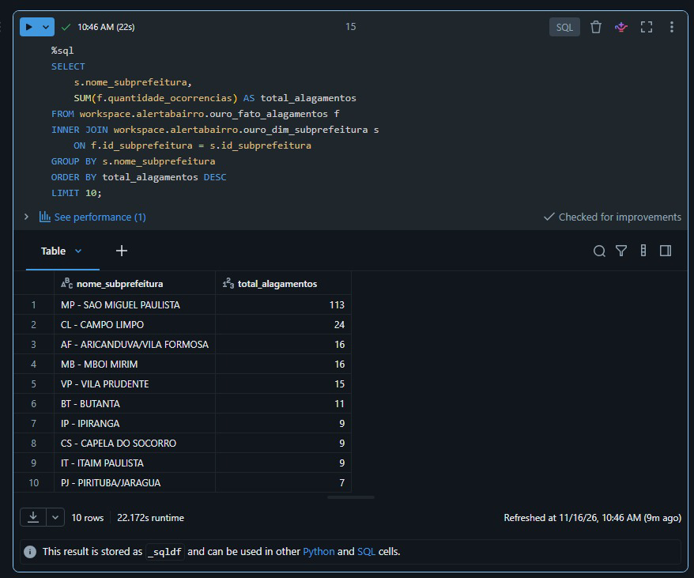
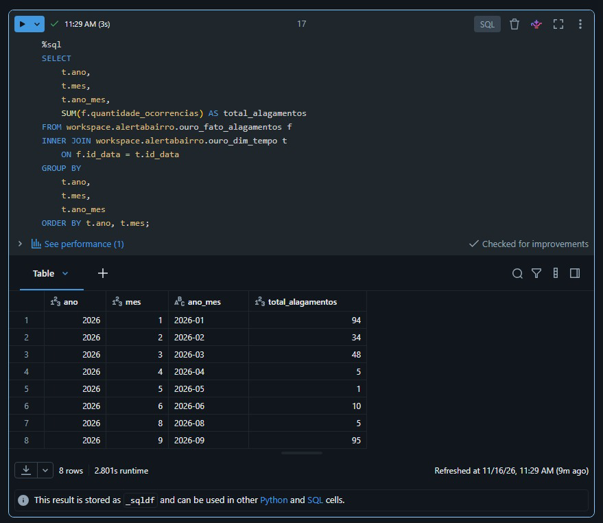
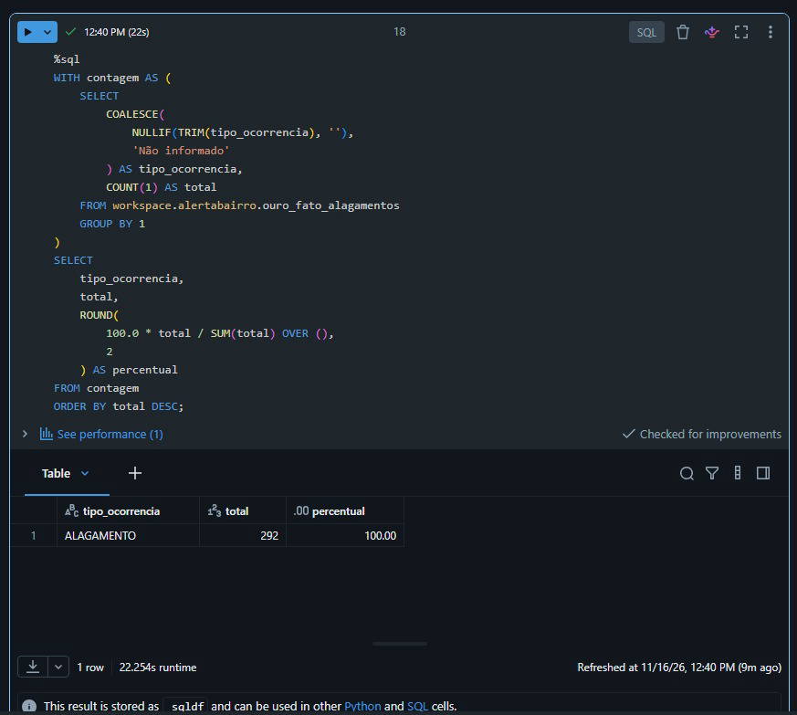
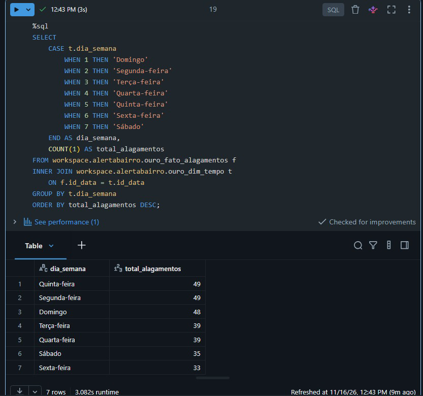
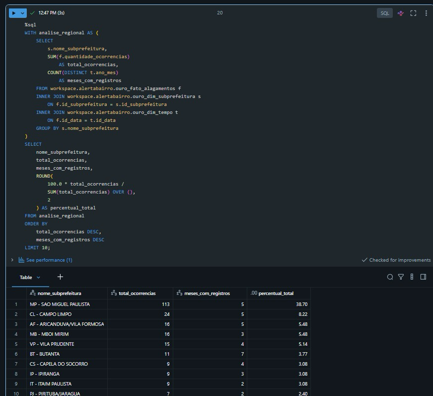
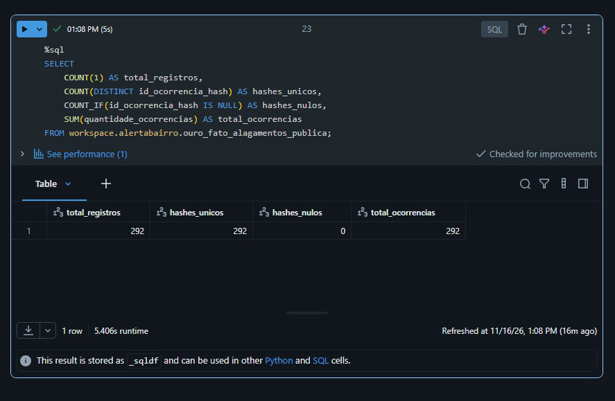
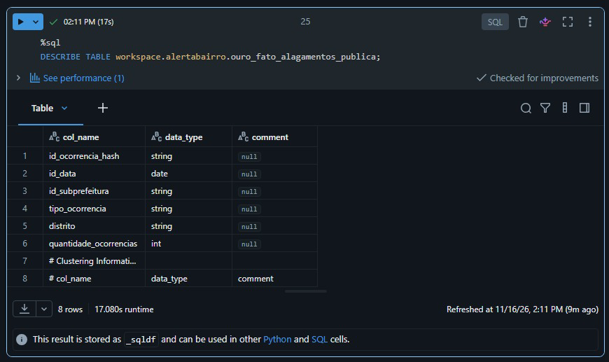

# Ouro - modelo dimensional, SQL e LGPD

Esta pasta reúne capturas reais fornecidas durante o desenvolvimento do AlertaBairro. Use os prints em tamanho original nas evidências do relatório.

### 01. Ouro - tabela fato com 292 ocorrências e IDs únicos

*Arquivo:* `01_validacao_fato_292.png` | *Critérios:* R07.

### 02. Ouro - dimensão tempo com 71 datas únicas

*Arquivo:* `02_validacao_dim_tempo_71.png` | *Critérios:* R07.

### 03. Ouro - junções válidas para tempo e subprefeitura

*Arquivo:* `03_integridade_fato_dimensoes.png` | *Critérios:* R07.

### 04. SQL 1 - ranking de alagamentos por subprefeitura

*Arquivo:* `04_consulta_1_ranking_regioes.png` | *Critérios:* R07.

### 05. SQL 2 - evolução mensal das ocorrências

*Arquivo:* `05_consulta_2_serie_mensal.png` | *Critérios:* R07.

### 06. SQL 3 - proporção por tipo de ocorrência

*Arquivo:* `06_consulta_3_tipo_ocorrencia.png` | *Critérios:* R07.

### 07. SQL 4 - distribuição por dia da semana

*Arquivo:* `07_consulta_4_dia_da_semana.png` | *Critérios:* R07.

### 08. SQL 5 - concentração/recorrência regional (proxy de impacto)

*Arquivo:* `08_consulta_5_impacto_regional.png` | *Critérios:* R07.

### 09. Ouro - tabela pública com 292 hashes únicos, nenhum nulo

*Arquivo:* `09_anonimizacao_hash_292.png` | *Critérios:* R08.

### 10. Ouro - esquema da tabela pública sem coordenadas exatas

*Arquivo:* `10_esquema_ouro_publica.png` | *Critérios:* R08.
