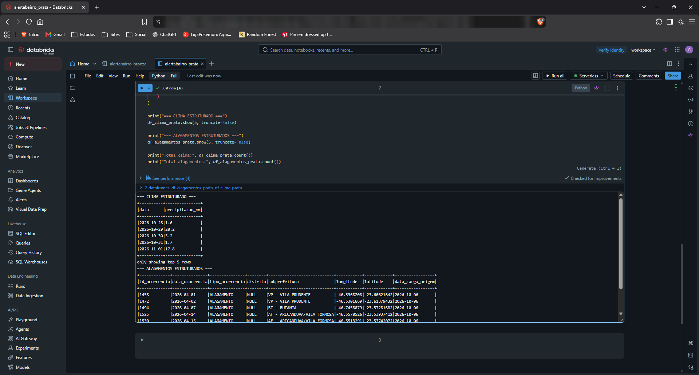
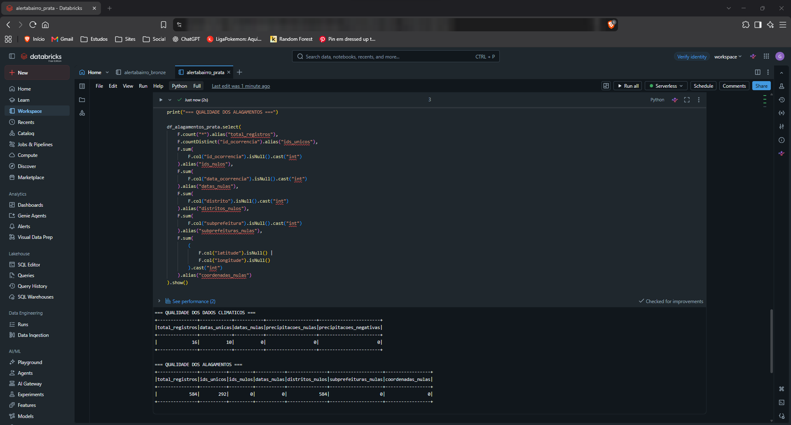
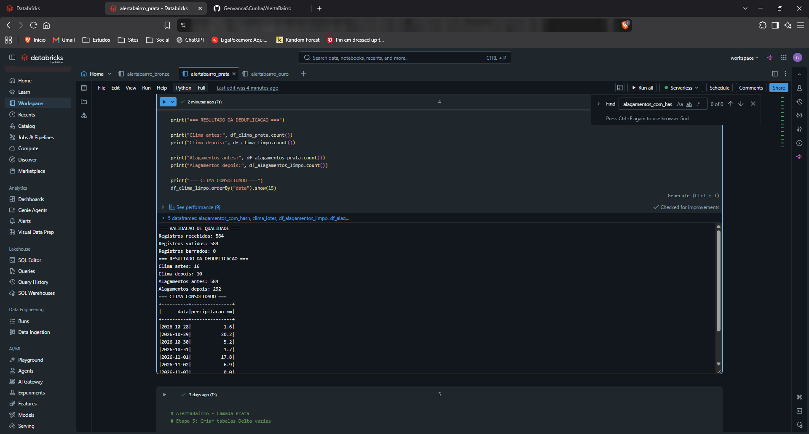
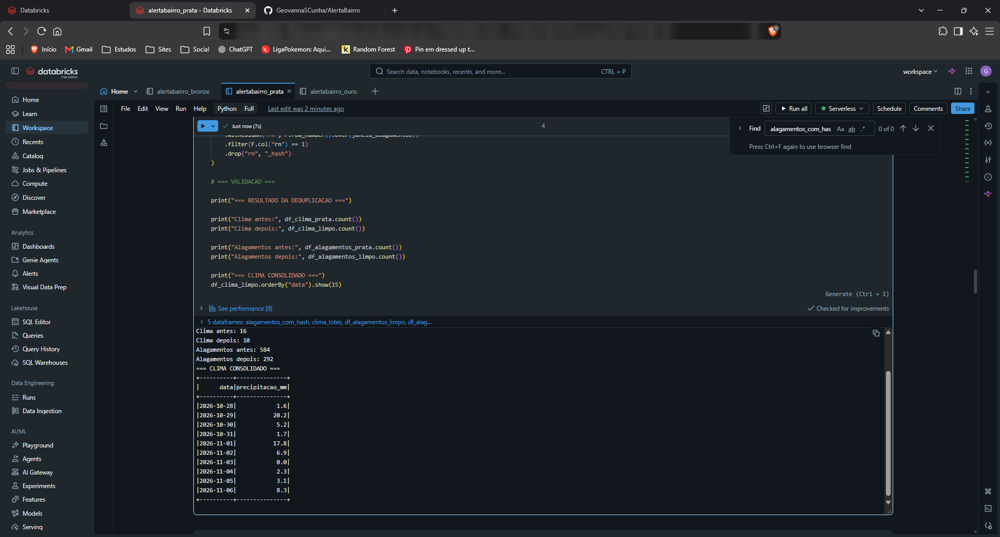
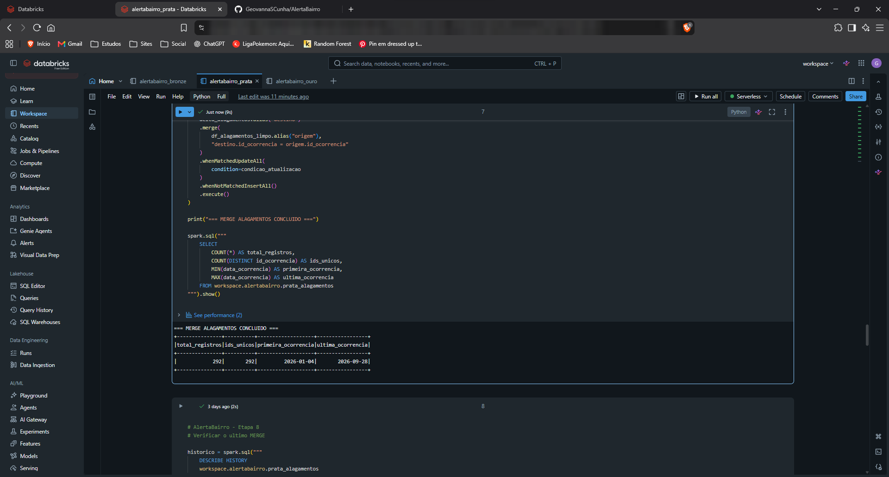
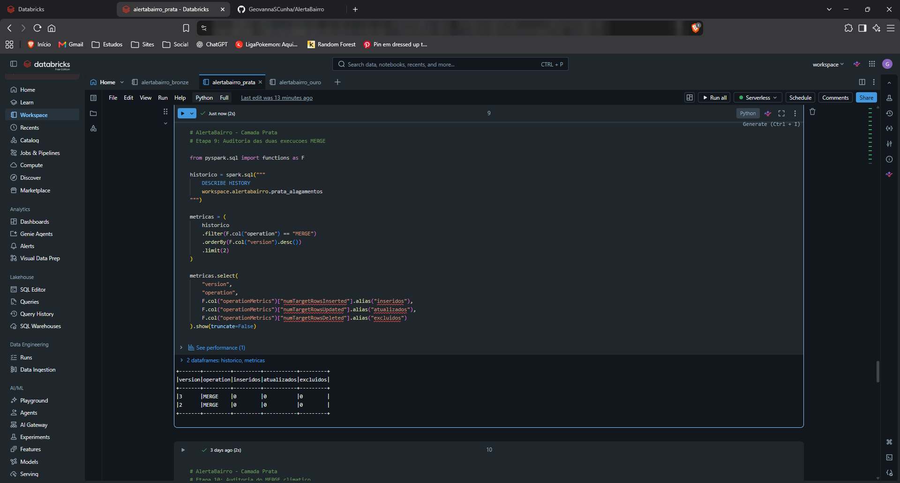
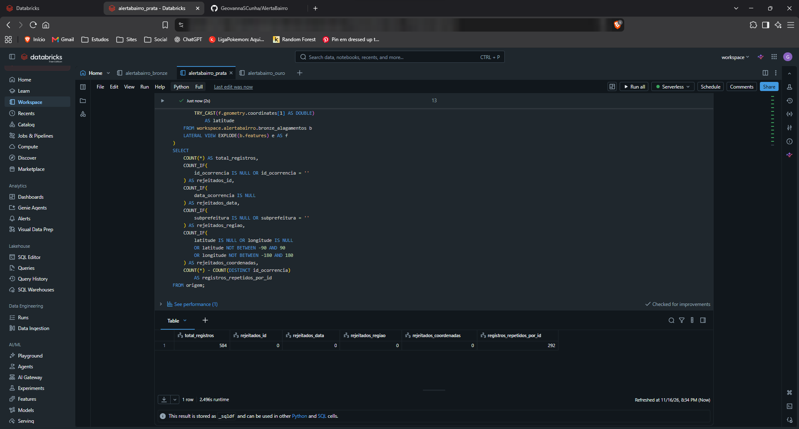

# Prata - qualidade e MERGE

Esta pasta reúne capturas reais fornecidas durante o desenvolvimento do AlertaBairro. Use os prints em tamanho original nas evidências do relatório.

### 01. Prata - amostras dos registros e transformação dos campos

*Arquivo:* `01_amostras_dados_tratados.png` | *Critérios:* R06.

### 02. Prata - inspeção de nulos, campos e duplicidades na origem

*Arquivo:* `02_regras_qualidade_origem.png` | *Critérios:* R06.

### 03. Prata - 584 recebidos, 584 válidos, nenhum barrado

*Arquivo:* `03_validacao_584_registros.png` | *Critérios:* R06.

### 04. Prata - alagamentos 584 para 292; clima 16 para 10

*Arquivo:* `04_deduplicacao_584_para_292.png` | *Critérios:* R06.

### 05. Prata - MERGE concluído e 292 IDs únicos

*Arquivo:* `05_merge_alagamentos_292_unicos.png` | *Critérios:* R06.

### 06. Prata - duas execuções MERGE sem inserts, updates ou deletes

*Arquivo:* `06_auditoria_merge_idempotencia.png` | *Critérios:* R06.

### 07. Consulta de auditoria de dados inválidos na origem

*Arquivo:* `07_contagens_regras_individuais.png` | *Critérios:* R06.

