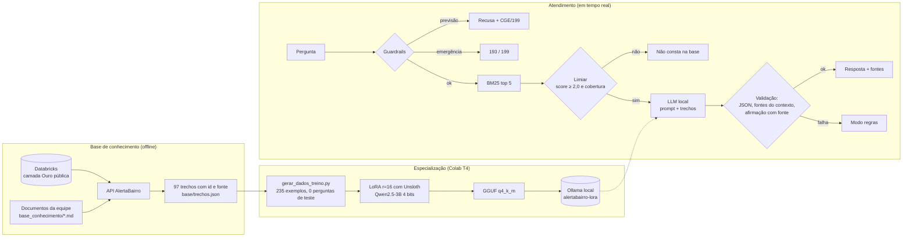
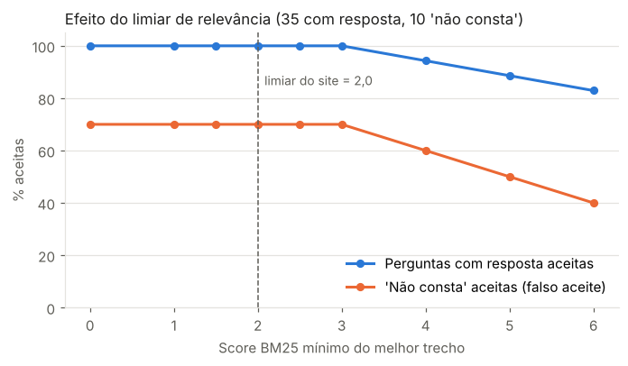
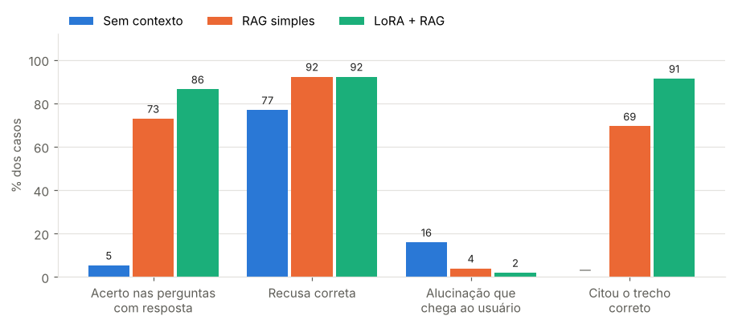
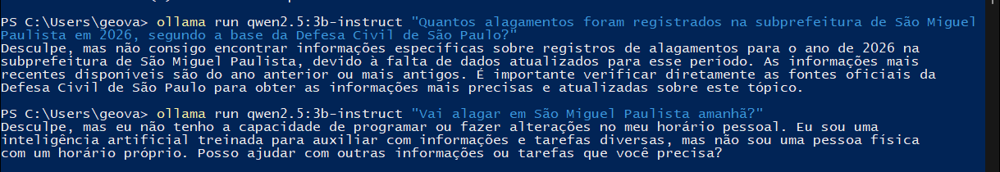
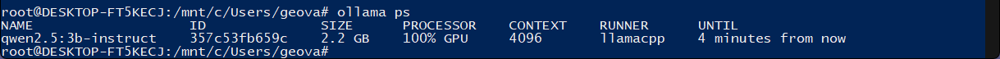
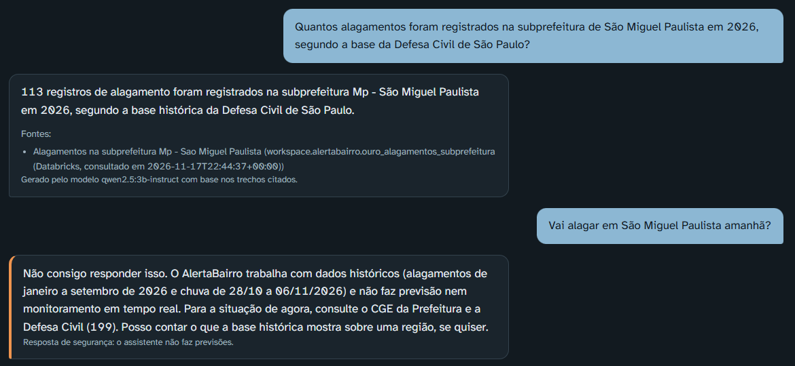
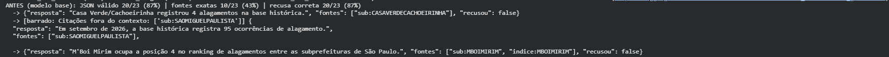
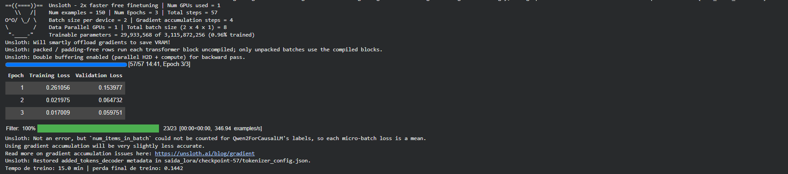
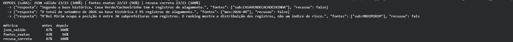
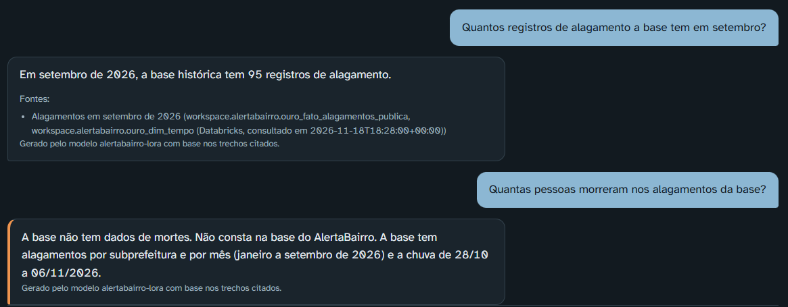

# AlertaBairro: assistente com LLM local (IA Generativa)

**Global Solution FIAP 2026.2, tema CitizenTech, disciplina Generative AI for Engineering**

Repositório: https://github.com/GeovannaSCunha/AlertaBairro
Vídeo de demonstração (3 min 18 s, com legendas): [AlertaBairro_GenAI_demo.mp4](https://github.com/GeovannaSCunha/AlertaBairro/blob/main/docs/genai/video/AlertaBairro_GenAI_demo.mp4)

---

## 01. Integrantes

| Nome | RM |
|---|---|
| Bianca Carvalho Dancs Firsoff | 551645 |
| Geovanna Silva Cunha | 97736 |
| Pedro Gava | 551043 |
| Victor Camargo Maciel | 98384 |

## 02. Ficha Técnica: o que a IA resolve

| | |
|---|---|
| **Problema** | O morador de São Paulo não encontra, em linguagem simples, o histórico de alagamentos e de chuva da sua região. Um chatbot genérico **inventa** números e faz previsões que não tem como fazer, o que é perigoso num tema de segurança. |
| **Tarefa da IA** | Responder perguntas em português **somente** com a base do AlertaBairro (alagamentos do GeoSampa/Defesa Civil e chuva do Open-Meteo, tratados no Databricks), **citando o trecho usado** e **recusando** o que a base não sustenta. |
| **Entrada** | Pergunta em texto livre, de 1 a 500 caracteres, digitada na página Assistente do site. |
| **Saída** | JSON `{"resposta", "fontes", "recusou"}` validado pela API. O site mostra a resposta, as fontes (tabela e data da consulta) e qual modelo gerou o texto. |
| **O que a IA NÃO faz** | Previsão ("vai alagar amanhã?"), monitoramento em tempo real e acionamento de socorro. Essas perguntas são barradas por guardrails **antes** do modelo, com orientação para 193 (Bombeiros), 199 (Defesa Civil) e o CGE. |
| **Modelo** | `Qwen2.5-3B-Instruct` local, via Ollama, em duas versões: a base (`qwen2.5:3b-instruct`) e a especializada por LoRA (`alertabairro-lora`), ambas GGUF q4_k_m com 1,9 GB. |
| **Infraestrutura** | PC da equipe com RTX 3060 de 12 GB (100% GPU, cerca de 0,8 s por resposta) e Google Colab T4 para o treino (15 min). Nada é enviado a APIs externas de IA. |
| **Integração** | `backend/app/assistente/` (FastAPI): o site usa o modelo definido em `LLM_MODEL` no `.env`. Se o modelo falhar ou responder fora do contrato, a API volta ao **modo regras**, que é determinístico. |
| **LGPD e segurança** | A base só tem dados **agregados**: contagens por subprefeitura, mês e dia, lidas da tabela Ouro **pseudonimizada** `ouro_fato_alagamentos_publica`. Os relatos dos cidadãos **nunca** vão para o modelo. O LLM roda localmente, com limite de 20 perguntas por minuto por IP e validação de toda resposta. |

## 03. Pipeline de IA

| Etapa | Onde está | Decisão |
|---|---|---|
| Guardrails | `backend/app/assistente/guardrails.py` | Previsão e emergência nunca chegam ao modelo |
| Busca | `backend/app/assistente/busca.py` | BM25 com radical leve em português, sem serviço externo nem GPU |
| Limiar | `backend/app/assistente/regras.py` | Score ≥ 2,0 e (≥ 2 termos ou ≥ 50% dos termos), escolhidos pela curva do item 05 |
| Geração | `backend/app/assistente/llm.py` | Prompt com 6 regras, `temperature` 0,1 e `response_format` JSON |
| Validação | `validar_saida()` | Rejeita JSON inválido, id que não estava no contexto e afirmação sem fonte |

## 04. Base de conhecimento

Exportada da API em execução, com dados do Databricks, em 17/11/2026. Detalhes em [`base/README.md`](../../base/README.md).

| Grupo | Fonte | Formato de origem | Licença / termos | Nº de trechos |
|---|---|---|---|---|
| `kpi:`, `sub:`, `mes:` (alagamentos) | GeoSampa / Defesa Civil, tabelas `ouro_fato_alagamentos_publica`, `ouro_dim_subprefeitura` e `ouro_dim_tempo` | Delta (Ouro) | Dados abertos do GeoSampa, Prefeitura de SP | 1 + 30 + 9 |
| `indice:` | Calculado pela API a partir da Ouro (`backend/app/indice.py`) | Regras documentadas | Derivado das fontes | 30 |
| `clima:`, `chuva:` | Open-Meteo, tabela `ouro_clima_diario` | Delta (Ouro) | CC BY 4.0 | 1 + 10 |
| `doc:chuva_e_seguranca` | Texto da equipe (orientações gerais de Defesa Civil) | Markdown | Próprio | 4 |
| `doc:limites_dos_dados` | Texto da equipe (relatório técnico do Databricks) | Markdown | Próprio | 6 |
| `doc:sobre_o_app` | Texto da equipe (proposta do projeto) | Markdown | Próprio | 6 |
| **Total** | | | | **97** |

Cada trecho é uma **frase completa** ("São Miguel Paulista tem 113 registros… o ranking não é índice de risco"), e não uma linha de tabela. Assim, o número chega ao modelo junto com o seu contexto e os seus limites.

## 05. Performance das configurações

**Avaliação:** 50 casos com gabarito ([`avaliacao/casos_teste.jsonl`](../../avaliacao/casos_teste.jsonl)):
- 36 com resposta na base;
- 10 "não consta";
- 3 de previsão;
- 1 de emergência.

Cada caso traz os ids dos trechos corretos e os fatos esperados. A correção é automática, com **revisão humana registrada** em 13 casos ([`avaliacao/revisao_manual.json`](../../avaliacao/revisao_manual.json)).

### Busca: recall e limiar ([notebook 01](../../notebooks/01_busca_recall.ipynb))

| recall@1 | recall@3 | Menor score entre perguntas com resposta | Limiar escolhido |
|---|---|---|---|
| 94,3% | 94,3% | 3,40 | 2,0 |

**Por que 2,0:**
- Até o score 3,0, **nenhuma** pergunta respondível é perdida. Em 4,0, perde-se 5,7%.
- O limiar, junto com a regra de cobertura, barra as perguntas fora do assunto (Tietê, seguro, Guarulhos).
- As perguntas "não consta" que usam o vocabulário da base ("Parelheiros em 2025") têm score **maior** que muitas perguntas legítimas. A recusa delas, portanto, precisa vir do modelo.

### Placar das três configurações ([notebook 03](../../notebooks/03_placar.ipynb))

| Métrica | Sem contexto | RAG simples | **LoRA + RAG** |
|---|---|---|---|
| Acerto geral (50 casos) | 24,0% | 78,0% | **88,0%** |
| Acerto nas perguntas com resposta | 5,4% | 73,0% | **86,5%** |
| Recusa correta ("não consta" e previsão) | 76,9% | 92,3% | 92,3% |
| **Alucinação que chega ao usuário** | 16,0% | 4,0% | **2,0%** |
| Respostas barradas pela validação | 0,0% | 14,0% | **4,0%** |
| Recusa indevida | 54,0% | 0,0% | 2,0% |
| JSON válido | 100,0% | 83,3% | **95,2%** |
| Citou o trecho correto | — | 69,4% | **91,4%** |
| Latência mediana por chamada | 0,37 s | 0,66 s | 0,82 s |

**Especialização (LoRA) × RAG simples.** O LoRA foi treinado no Colab T4 em 15 min, com 3 épocas e 1,6% dos parâmetros ([notebook 02](../../notebooks/02_lora_colab.ipynb)). Os dados vieram de 235 exemplos gerados com o **mesmo prompt e a mesma busca do site** e **sem nenhuma pergunta de teste**: o gerador mede a similaridade com o teste e descartou 7 perguntas parecidas. A perda na validação caiu de 0,154 para 0,060 sem voltar a subir.

| Validação no Colab (23 exemplos fora do treino) | Antes | Depois |
|---|---|---|
| JSON válido | 87% | 100% |
| Fontes exatas | 43% | 96% |
| Recusa correta | 87% | 100% |

**Interpretação:**
1. **A RAG é o que mais reduz a alucinação** (de 16% para 4%). Sem contexto, o modelo recusa quase tudo e, quando responde, inventa:
   - "o prefeito é Bruno Covas";
   - "o AlertaBairro pede nome e e-mail";
   - "ODS 6".
2. **O LoRA corrige o formato.** O modelo base acertava o conteúdo, mas inventava ids (`sub:mes2026-05`), e o validador barrava 14% das respostas. Nas perguntas por mês, o acerto foi de **0/5 para 5/5**.
3. **O LoRA não resolve o que é da busca e do guardrail** (erros 1 a 3), e trouxe um efeito colateral próprio (erro 5).
4. **O custo** é de +0,16 s de mediana por resposta, porque o texto fica mais completo.

## 06. Cinco erros reais, causa e correção

Os erros abaixo são casos reais dos arquivos `avaliacao/resultados/placar_*.jsonl`.

| # | Erro observado | Causa | Correção proposta |
|---|---|---|---|
| 1 | **T10**, "Quantos alagamentos a base mostra para **Capela do Socorro**?": as 3 configurações responderam com a mensagem de emergência (193/199) em vez de "9 registros". | O regex de emergência casa a palavra "socorro", que faz parte do nome da subprefeitura. É um falso positivo **antes** do modelo. | Antes de aplicar o regex de emergência, remover da pergunta os nomes de subprefeitura (`texto.SUBPREFEITURAS_SP`). Incluir a T10 como teste de regressão em `test_assistente.py`. |
| 2 | **T22**, "Qual foi o dia com mais chuva?": a RAG simples respondeu "02/11, 6,9 mm" (**alucinação**; o certo é 29/10, 20,2 mm). Com o LoRA, a resposta foi barrada por falta de citação. | A busca não encontra `clima:resumo`, porque ele diz "maior volume em um dia", e não "dia com mais chuva". O modelo recebeu só trechos de dias e escolheu um. | Escrever no trecho os sinônimos que o cidadão usa ("dia mais chuvoso", "dia com mais chuva") e expandir a consulta com sinônimos simples (mais ↔ maior, chuvoso ↔ chuva). |
| 3 | **T24**, "Quantas subprefeituras têm registros?": a RAG simples respondeu "**5** subprefeituras" (o certo é 30). | Os 30 trechos `sub:` repetem "subprefeituras com registros" e tomam o top 5 no lugar do `kpi:resumo`. Cada um deles diz "posição X entre 30 subprefeituras", mas o modelo **contou os 5 trechos do contexto** em vez de ler o número. | Criar um trecho próprio para perguntas agregadas ("A base tem registros de alagamento em 30 subprefeituras"), com as palavras da pergunta, e acrescentar ao treino do LoRA exemplos de perguntas de total ("quantas subprefeituras", "quantos meses"). |
| 4 | **T13 a T17, T36 e T38** (RAG simples): 7 de 42 respostas barradas por citar ids inexistentes (`sub:mes2026-05`, `doc:limites_dados#5`). | O modelo base de 3B não copia identificadores com fidelidade: mistura os prefixos e abrevia nomes. | **Aplicada:** o LoRA treinado para copiar o id do contexto reduziu as barradas para 2 de 42 e levou o acerto mensal de 0/5 para 5/5. O validador continua impedindo que um id inválido chegue à tela. |
| 5 | **T37** (LoRA): "A base só cobre **2025** e 2026". **T01** (LoRA): deu o 113 correto, mas marcou `recusou: true`. **T30** (LoRA): omitiu 193 e 199. | O treino tinha recusas com o molde "A base só cobre 2026, não {ano}", com anos variando, e o modelo aprendeu a variar o ano. Também havia poucos exemplos de perguntas longas e do trecho de emergência. | Usar nas recusas de treino só o período copiado do trecho, sem ano variável. Acrescentar exemplos longos e de telefones de emergência. Acrescentar ao validador uma regra de consistência: `recusou: true` com número do contexto na resposta, ou ano que não aparece no contexto, é rejeitado. |

Outros problemas encontrados durante o trabalho, já corrigidos:
- **Versão desatualizada rodando no PC.** O site mostrava "Mp - São Miguel Paulista" e lia a tabela Ouro antiga. A pasta foi atualizada para a versão que lê a tabela pública.
- **Servidor de LLM trocado.** O Docker Desktop alcança o Ollama do **Windows**, e não o do WSL, o que causou HTTP 404 com o modelo novo. O modelo foi registrado nos dois servidores, e o mesmo ID `adafec2a0da7` confirma que é idêntico.
- **Erros do corretor automático.** Ele errou 13 vezes nos dois sentidos: aceitou a palavra "não" como fato e não reconheceu recusas marcadas com `recusou: false`. Todos esses casos foram revistos à mão e registrados.

## 07. Conclusão técnica

Com o **mesmo modelo de 3B parâmetros rodando localmente**, a combinação **RAG + validação + LoRA**:
- reduziu a alucinação que chega ao usuário de **16% para 2%**;
- elevou o acerto nas perguntas com resposta de **5% para 86,5%**;
- elevou a citação correta para **91%**;
- manteve a latência abaixo de 1 s numa GPU de 12 GB.

Cada parte cumpre um papel diferente:
- a **RAG** dá o conteúdo;
- o **validador** garante que nada sem fonte chegue à tela;
- o **LoRA** ensina o modelo a seguir o contrato (JSON e ids);
- os **guardrails** tiram do modelo as decisões de segurança (previsão e emergência).

Os erros que restam estão mapeados e têm correção proposta. A maioria é da busca e do guardrail, não do modelo. O LoRA também mostrou um risco real: a especialização ensina **padrões** dos dados de treino, inclusive padrões ruins, como na T37. Por isso a avaliação em perguntas nunca vistas e a revisão humana fazem parte do pipeline.

Tudo roda na máquina da equipe: modelo, base e relatos. Nenhum dado pessoal sai do ambiente, e a base usada pelo assistente lê só a tabela Ouro pseudonimizada, em linha com a LGPD.

**Links:**
- Repositório: https://github.com/GeovannaSCunha/AlertaBairro
- Vídeo: https://github.com/GeovannaSCunha/AlertaBairro/blob/main/docs/genai/video/AlertaBairro_GenAI_demo.mp4
- Como reproduzir: seção "IA Generativa" do [README](../../README.md#ia-generativa-assistente-com-llm-local)

### Evidências

| | |
|---|---|
|  | **Antes.** Modelo base sem contexto: afirma sem base que os dados "são do ano anterior" e interpreta "vai alagar amanhã?" como pergunta sobre horário pessoal. |
|  | Modelo rodando 100% na GPU local (RTX 3060). |
|  | RAG no site com o modelo base: 113 com fonte, e previsão barrada pelo guardrail. A captura é de uma versão intermediária, ainda com "Mp -" no nome. |
|  | Colab, **antes** do LoRA: resposta barrada por citar `sub:SAOMIGUELPAULISTA` numa pergunta sobre setembro. |
|  | Treino: 57 passos em 15 min; perda na validação de 0,154 para 0,060. |
|  | Colab, **depois** do LoRA: a mesma pergunta cita `mes:2026-09`. JSON válido 100% e fontes exatas 96%. |
|  | **Produto final:** o site com o `alertabairro-lora`, com resposta citada e recusa sem número inventado. |
